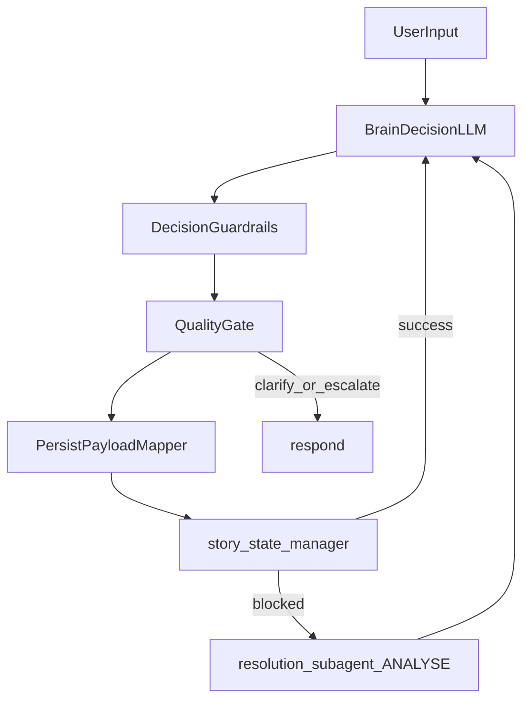

# Brain Rewrite Plan (Autonomous-but-Bounded)

## Findings (Why the current brain fails persistently)

- The current brain permits invalid delegation envelopes (`delegate` with missing/weak `worker`/`task` semantics), and routing then falls back to `respond` paths that can terminate turns without meaningful progression, especially visible in bootstrap failures.
- Quality gating is under-enforced in code relative to prompt intent: non-empty artifacts can pass without strong per-task validation, allowing malformed persistence handoffs.
- Bootstrap failures are concentrated at the brain-to-persistence contract boundary: creative artifacts are not consistently normalized into write-ready payloads before `story_state_manager`, which leads to early turn collapse and missing expected KG records.
- Structured output reliability is fragile under nested schema parsing; fallback exists but should be rebuilt as a first-class, observable path rather than emergency behavior.
- Brain autonomy is desirable and should be preserved, but must be bounded by hard runtime constraints (contract validity, contradiction handling, persistence-before-continue, reject budget behavior).

Primary evidence reviewed:
- [src/brain.py](src/brain.py)
- [src/state.py](src/state.py)
- [src/orchestrator.py](src/orchestrator.py)
- [src/prompts/brain.md](src/prompts/brain.md)
- [E2E_BOOTSTRAP_DIAGNOSIS.md](E2E_BOOTSTRAP_DIAGNOSIS.md)
- [test_brain_node.py](test_brain_node.py)
- [test_e2e_full_stack.py](test_e2e_full_stack.py)
- [ORCHESTRATOR_SPEC.md](ORCHESTRATOR_SPEC.md)

## Confirmed Product/Design Decisions

- Decisioning mode: autonomous-but-bounded (agentic brain with strict hard guardrails).
- LLM output strategy: nested structured schema primary + flattened fallback (Option A).
- Persistence contract owner: brain-side mapping layer, abstracted as internal chain/subgraph-style component (not ad hoc inline handling everywhere).
- Missing/invalid quality assessment on creative success: reject by default.
- Reject budget exhaustion behavior: escalate via targeted clarify (not silent stop).
- Initiative level: high proactive.
- Clarification style: short batched questions.
- Freeform orchestration: allowed within hard safety/business guardrails.
- On persistence blocked: never bypass contradiction resolution.
- Scope: end-to-end path (brain + state/prompt + orchestrator touchpoints + E2E updates).
- Bootstrap phase memory: minimal now (no heavy new phase-state framework in pass 1).
- User visibility: keep retries/rejections mostly internal; surface only on clarify/escalation.

## Target Architecture (Pass 1)

## Detailed Action Plan

### 1) Rebuild decision contract and guardrail pipeline in brain

- Replace current monolithic decision post-processing in [src/brain.py](src/brain.py) with explicit internal stages:
  - `invoke_decision_model()` using Option A (nested primary + flat fallback).
  - `sanitize_and_validate_decision()` enforcing delegate invariants (`worker` required and valid, non-empty `task`, `context` dict normalization).
  - `apply_infrastructure_overrides()` for deterministic blocked->resolution routing.
  - `apply_quality_gate()` for creative worker outputs with reject-by-default when assessment missing/invalid.
  - `apply_reject_budget_policy()` with escalation via `clarify` after budget exhaustion.
  - `build_state_updates()` with consistent response/delegation shaping.
- Keep autonomy: LLM still proposes next actions; code only hard-stops invalid or unsafe transitions.

### 2) Introduce brain-side persistence mapping abstraction

- Add a dedicated internal mapper component (new module under `src/`), referenced by brain, to transform accepted creative artifacts into write-ready payloads.
- Mapper behavior in pass 1:
  - Normalize canonical write keys (`nodes_to_add`, `edges_to_add`, `nodes_to_update`, `edges_to_update`).
  - Preserve chapter context propagation.
  - Reject/flag malformed payloads before delegating `story_state_manager`.
- Keep design extensible so this mapper can evolve into a richer subgraph/chain later without changing brain contracts.

### 3) Align state schema with rewritten decision flow

- Update [src/state.py](src/state.py) schemas to strengthen action-coupled constraints and fallback compatibility while preserving Option A.
- Ensure runtime enforcement does not rely only on Pydantic shape; code-level validators in brain remain authoritative.
- Keep worker set single-sourced and routing-safe across brain/orchestrator.

### 4) Rewrite brain prompt as autonomy policy, not brittle procedure

- Refactor [src/prompts/brain.md](src/prompts/brain.md) to emphasize:
  - high-proactive autonomous planning,
  - bounded constraints and non-negotiable safety rules,
  - reject-by-default behavior when quality signal is insufficient,
  - concise batched clarification style,
  - contradiction non-bypass and persist-before-continue.
- Reduce ambiguity around what is optional vs mandatory in quality and persistence handoffs.

### 5) Wire orchestrator touchpoints for deterministic fallback safety

- Update [src/orchestrator.py](src/orchestrator.py) only where needed to guarantee safe terminal behavior when brain emits edge-case decisions.
- Preserve existing graph topology and worker boundaries; only harden response/routing seams required by rewritten brain contract.

### 6) Expand and realign tests to the new behavior

- Rewrite/add targeted tests in [test_brain_node.py](test_brain_node.py) for:
  - invalid delegate envelopes (worker/task/context) repair or safe escalation,
  - nested parse failure -> flat fallback correctness,
  - reject-by-default when quality assessment missing on creative success,
  - reject budget escalation via clarify,
  - blocked persistence deterministic resolution route.
- Update [test_e2e_full_stack.py](test_e2e_full_stack.py) expectations where necessary to align with clarified reject/escalation semantics while preserving core success criteria (bootstrap records + first scene).

### 7) Validate against known failure signature

- Re-run scenarios described in [E2E_BOOTSTRAP_DIAGNOSIS.md](E2E_BOOTSTRAP_DIAGNOSIS.md) and verify the rewritten brain no longer regresses into early terminate-without-persist paths.
- Confirm end-to-end reliability objective: successful autonomous progression through bootstrap and first-scene cycle under bounded guardrails.

## Files Expected to Change

- [src/brain.py](src/brain.py) (major rewrite)
- [src/state.py](src/state.py) (schema and compatibility updates)
- [src/prompts/brain.md](src/prompts/brain.md) (policy rewrite)
- [src/orchestrator.py](src/orchestrator.py) (targeted routing/respond hardening)
- `src/<new_brain_persistence_mapper_module>.py` (new internal abstraction)
- [test_brain_node.py](test_brain_node.py) (rewritten unit behavior coverage)
- [test_e2e_full_stack.py](test_e2e_full_stack.py) (E2E expectation alignment)

## Acceptance Criteria

- Brain remains autonomous in delegation strategy but never emits unsafe/invalid execution envelopes.
- Creative success without valid quality assessment is rejected by default.
- Reject budget exhaustion triggers targeted clarify escalation.
- Accepted creative artifacts are transformed into valid write payloads before `story_state_manager`.
- `story_state_manager` blocked always routes to `resolution_subagent` ANALYSE first.
- E2E bootstrap + first-scene test passes with expected KG shape and no early orchestration collapse.
