# MongoDB Knowledge Graph Schema for GRRM Agent

Based on the principles in `KG_FOR_LLM.txt` and the verified World Bible modules in `grrm_agent_specs.md` and the `skills` directory, this schema uses a **two-collection design** (`nodes` and `edges`). This provides the flexibility of a graph structure while leveraging MongoDB's scalability and querying capabilities.

## 1. Core Architecture

- **`nodes` collection**: Stores all entities (Characters, Locations, Events, Threads, etc.). Everything that evolves or has independent properties is a node.
- **`edges` collection**: Stores all relationships between nodes. Edges are first-class citizens and contain their own properties (e.g., relationship dynamics, knowledge acquisition details).
- **Temporal Versioning**: Both nodes and edges include `valid_from` and `valid_to` fields (typically tracking the *Chapter Number*) to maintain historical state and prevent contradictions.

---

## 2. `nodes` Collection

### Base Schema
```json
{
  "_id": "string",           // e.g., "char_jon_snow", "event_red_wedding"
  "type": "string",          // Entity category
  "valid_from": "integer",   // Chapter number this state became true
  "valid_to": "integer",     // Chapter number this state ended (null if current)
  "properties": "object"     // Type-specific attributes
}
```

### Node Types & Properties Mapping

**1. Character** *(Module 1.1)*
```json
{
  "type": "Character",
  "properties": {
    "full_name": "string",
    "aliases": ["string"],
    "age": "integer",
    "gender": "string",
    "physical_description": "string",
    "faction": "string",
    "rank": "string",
    "occupation": "string",
    "public_vs_private_reputation": "string",
    "location": "string",
    "surface_beliefs": ["string"],
    "core_wound": "string",
    "core_desire": "string",
    "core_fear": "string",
    "self_deception": "string",
    "values_under_pressure": ["string"],
    "contradictions": ["string"],
    "response_patterns": "object",
    "arc_type": "string",
    "arc_stage": "string",
    "pov_eligible": "boolean",
    "pov_chapter_count": "integer",
    "last_pov_chapter": "integer",
    "injuries_physical_state": ["string"],
    "emotional_state": "string"
  }
}
```

**2. Location** *(Module 3.2)*
```json
{
  "type": "Location",
  "properties": {
    "name": "string",
    "description": "string",
    "climate": "string",
    "seasonal_weather_state": "string"
  }
}
```

**3. Event** *(Modules 2.1, 3.4, 4.1)*
```json
{
  "type": "Event",
  "properties": {
    "name": "string",
    "absolute_date": "string",
    "summary": "string",
    "is_historical": "boolean",
    // If is_historical is true:
    "true_account": "string",
    "believed_account": "string",
    "factional_interpretations": "object",
    "physical_remnants": ["string"],
    "story_significance": "string",
    "referenced_in_chapters": ["integer"]
  }
}
```

**4. Faction** *(Module 3.1)*
```json
{
  "type": "Faction",
  "properties": {
    "name": "string",
    "core_values": ["string"],
    "military_assets": "string",
    "economic_assets": "string"
  }
}
```

**5. Culture** *(Module 3.3)*
```json
{
  "type": "Culture",
  "properties": {
    "name": "string",
    "core_values": ["string"],
    "core_fears": ["string"],
    "key_customs": ["string"],
    "class_structure": "string",
    "gender_dynamics": "string",
    "religious_beliefs": "string",
    "political_power": "string",
    "languages_dialects": ["string"]
  }
}
```

**6. KnowledgeItem** *(Module 1.2, 5.2)*
```json
{
  "type": "KnowledgeItem",
  "properties": {
    "description": "string"
  }
}
```

**7. PlotThread** *(Module 2.3)*
```json
{
  "type": "PlotThread",
  "properties": {
    "name": "string",
    "status": "string", // Active / Dormant / Resolved / Abandoned
    "originating_chapter": "integer",
    "expected_convergence_window": "string",
    "resolution_summary": "string",
    "abandonment_rationale": "string"
  }
}
```

**8. Payoff / Consequence Bomb** *(Modules 2.4, 4.2)*
```json
{
  "type": "Payoff",
  "properties": {
    "type": "string", // Chekhov's gun / Foreshadowing / Consequence bomb / Prophecy / In-world legend
    "description": "string",
    "planted_in_chapter": "integer",
    "narrative_phase_anchor": "string", // early / mid / convergence / final act
    "detonation_trigger": "string", // Condition-based trigger
    "resolution_status": "string", // Pending / Paid off / Overdue
    "priority_tier": "string", // Essential / Enriching / Unclassified
    "dual_register": "boolean"
  }
}
```

**9. Chapter** *(Module 2.2)*
```json
{
  "type": "Chapter",
  "properties": {
    "chapter_number": "integer",
    "pov_character": "string",
    "location": "string",
    "scene_summary": "string",
    "cliffhanger_status": "string",
    "connections": ["string"],
    "chapter_delta": "string"
  }
}
```

**10. MagicSystem** *(Module 3.5)*
```json
{
  "type": "MagicSystem",
  "properties": {
    "prevalence": "string", // Rare / Increasing / Decreasing / Stable
    "confirmed_capabilities": ["string"],
    "confirmed_limits": ["string"],
    "confirmed_costs": ["string"],
    "unexplained_phenomena": ["string"],
    "recent_magical_events": ["string"]
  }
}
```

**11. CascadeChain** *(Module 4.3)*
```json
{
  "type": "CascadeChain",
  "properties": {
    "sequence": ["string"], // Array of conditions/events
    "current_position": "string",
    "remaining_links": ["string"]
  }
}
```

**12. PhysicalDetail** *(Module 5.1)*
```json
{
  "type": "PhysicalDetail",
  "properties": {
    "subject_id": "string",
    "detail": "string",
    "established_in_chapter": "integer",
    "last_referenced_in_chapter": "integer"
  }
}
```

**13. Contradiction** *(Module 5.3)*
```json
{
  "type": "Contradiction",
  "properties": {
    "nature": "string", // Physical / Logical / Knowledge / Timeline
    "description": "string",
    "detected_at_chapter": "integer",
    "resolution_status": "string", // Unresolved / Resolved / Accepted as intentional ambiguity
    "resolution_notes": "string"
  }
}
```

---

## 3. `edges` Collection

### Base Schema
```json
{
  "_id": "string",
  "type": "string",          // Edge relationship type
  "from": "string",          // Node _id
  "to": "string",            // Node _id
  "valid_from": "integer",   // Chapter number
  "valid_to": "integer",     // Chapter number (null if current)
  "properties": "object"     // Relationship-specific attributes
}
```

### Edge Types & Properties Mapping

**1. `KNOWS`** *(Module 1.2 - Character → KnowledgeItem)*
```json
{
  "type": "KNOWS",
  "properties": {
    "status": "string", // KNOWS / BELIEVES / SUSPECTS / DOES NOT KNOW
    "acquired_at_chapter": "integer",
    "source": "string",
    "dramatic_irony_flag": "boolean"
  }
}
```

**2. `RELATIONSHIP`** *(Module 1.3 - Character → Character)*
```json
{
  "type": "RELATIONSHIP",
  "properties": {
    "emotional_valence": "string",
    "power_dynamic": "string",
    "history": "string",
    "secrets_kept": ["string"],
    "trajectory": "string",
    "convergence_potential": "string",
    "most_recent_interaction": "string"
  }
}
```

**3. `LOCATED_AT`** *(Character / Event → Location)*
```json
{
  "type": "LOCATED_AT",
  "properties": {
    "arrival_chapter": "integer",
    "departure_date": "string",
    "arrival_date": "string",
    "travel_duration": "string"
  }
}
```

**4. `CAUSES`** *(Module 4.1 - Event → Event / Payoff)*
```json
{
  "type": "CAUSES",
  "properties": {
    "consequence_type": "string", // Immediate / Short-term / Long-term
    "cascade_chain_id": "string"
  }
}
```

**5. `CONTROLS`** *(Module 3.1 - Faction / Character → Location)*
```json
{
  "type": "CONTROLS",
  "properties": {
    "held_since_chapter": "integer",
    "stability_rating": "string"
  }
}
```

**6. `INVOLVES`** *(Module 2.3, 4.3 - PlotThread / CascadeChain → Character / Event)*
```json
{
  "type": "INVOLVES",
  "properties": {
    "role": "string"
  }
}
```

**7. `PAYS_OFF_IN`** *(Module 2.4 - Payoff → Event)*
```json
{
  "type": "PAYS_OFF_IN",
  "properties": {
    "payoff_chapter": "integer"
  }
}
```

**8. `ALLIED_WITH` / `AT_WAR_WITH`** *(Module 3.1 - Faction → Faction)*
```json
{
  "type": "ALLIED_WITH", // or AT_WAR_WITH
  "properties": {
    "established_in_chapter": "integer",
    "stability": "string"
  }
}
```

**9. `CONNECTED_TO`** *(Module 3.2 - Location → Location)*
```json
{
  "type": "CONNECTED_TO",
  "properties": {
    "distance": "string",
    "travel_times": {
      "foot": "string",
      "horse": "string",
      "ship": "string"
    }
  }
}
```

**10. `BELONGS_TO_CULTURE`** *(Module 3.3 - Character → Culture)*
```json
{
  "type": "BELONGS_TO_CULTURE",
  "properties": {
    "role": "string"
  }
}
```

**11. `DEPENDS_ON`** *(Module 2.3 - PlotThread → PlotThread)*
```json
{
  "type": "DEPENDS_ON",
  "properties": {
    "dependency_type": "string"
  }
}
```

**12. `DESCRIBES`** *(Module 5.1 - PhysicalDetail → Character / Location / Object)*
```json
{
  "type": "DESCRIBES",
  "properties": {
    "relevance": "string"
  }
}
```

**13. `INFORMED`** *(Module 5.2 - Character → Character)*
```json
{
  "type": "INFORMED",
  "properties": {
    "knowledge_item_id": "string",
    "chapter_reference": "integer",
    "method": "string" // Spoken / Written / Overheard / Inferred
  }
}
```

**14. `CONFLICTS_WITH`** *(Module 5.3 - Contradiction → Node / Edge)*
```json
{
  "type": "CONFLICTS_WITH",
  "properties": {
    "conflict_side": "string" // e.g., "A" or "B" to distinguish the two conflicting records
  }
}
```

---

## 5. Logical Entity-Relationship Diagram (ERD)

The following diagram visualizes the logical relationships between the different `Node` types, connected by the `Edge` types.

```mermaid
erDiagram
    %% Node Types
    Character {
        string _id PK
        string type "Character"
        integer valid_from
        integer valid_to
        object properties "full_name, core_desire, etc."
    }
    Location {
        string _id PK
        string type "Location"
        integer valid_from
        integer valid_to
        object properties "name, climate, etc."
    }
    Event {
        string _id PK
        string type "Event"
        integer valid_from
        integer valid_to
        object properties "name, absolute_date, etc."
    }
    Faction {
        string _id PK
        string type "Faction"
        integer valid_from
        integer valid_to
        object properties "name, military_assets, etc."
    }
    Culture {
        string _id PK
        string type "Culture"
        integer valid_from
        integer valid_to
        object properties "name, core_values, etc."
    }
    KnowledgeItem {
        string _id PK
        string type "KnowledgeItem"
        integer valid_from
        integer valid_to
        object properties "description"
    }
    PlotThread {
        string _id PK
        string type "PlotThread"
        integer valid_from
        integer valid_to
        object properties "name, status, etc."
    }
    Payoff {
        string _id PK
        string type "Payoff"
        integer valid_from
        integer valid_to
        object properties "type, detonation_trigger, etc."
    }
    Chapter {
        string _id PK
        string type "Chapter"
        integer valid_from
        integer valid_to
        object properties "chapter_number, pov_character, etc."
    }
    MagicSystem {
        string _id PK
        string type "MagicSystem"
        integer valid_from
        integer valid_to
        object properties "prevalence, confirmed_capabilities, etc."
    }
    CascadeChain {
        string _id PK
        string type "CascadeChain"
        integer valid_from
        integer valid_to
        object properties "sequence, current_position, etc."
    }
    PhysicalDetail {
        string _id PK
        string type "PhysicalDetail"
        integer valid_from
        integer valid_to
        object properties "detail, established_in_chapter, etc."
    }
    Contradiction {
        string _id PK
        string type "Contradiction"
        integer valid_from
        integer valid_to
        object properties "nature, description, etc."
    }

    %% Relationships (Edges)
    Character }|--|{ KnowledgeItem : "KNOWS (status, acquired_at)"
    Character }|--|{ Character : "RELATIONSHIP (valence, power_dynamic)"
    Character }|--|{ Location : "LOCATED_AT (arrival_chapter)"
    Event }|--|{ Location : "LOCATED_AT"
    Event }|--|{ Event : "CAUSES (consequence_type)"
    Event }|--|{ Payoff : "CAUSES"
    Faction }|--|{ Location : "CONTROLS (held_since)"
    Character }|--|{ Location : "CONTROLS"
    PlotThread }|--|{ Character : "INVOLVES (role)"
    PlotThread }|--|{ Event : "INVOLVES"
    CascadeChain }|--|{ Character : "INVOLVES"
    CascadeChain }|--|{ Event : "INVOLVES"
    Payoff }|--|| Event : "PAYS_OFF_IN (payoff_chapter)"
    Faction }|--|{ Faction : "ALLIED_WITH / AT_WAR_WITH"
    Location }|--|{ Location : "CONNECTED_TO (distance, travel_times)"
    Character }|--|{ Culture : "BELONGS_TO_CULTURE"
    PlotThread }|--|{ PlotThread : "DEPENDS_ON"
    PhysicalDetail }|--|| Character : "DESCRIBES"
    PhysicalDetail }|--|| Location : "DESCRIBES"
    Character }|--|{ Character : "INFORMED (knowledge_item_id, method)"
    Contradiction }|--|{ Character : "CONFLICTS_WITH"
    Contradiction }|--|{ Event : "CONFLICTS_WITH"
```



To ensure the LLM agent can rapidly retrieve context without loading the entire graph, the following indexes are critical:

**`nodes` Collection:**
- `{ "type": 1, "valid_to": 1 }` (Fetch all active characters, active threads, etc.)
- `{ "_id": 1, "valid_to": 1 }` (Fetch current state of a specific entity)

**`edges` Collection:**
- `{ "from": 1, "type": 1, "valid_to": 1 }` (e.g., What does Arya know *right now*?)
- `{ "to": 1, "type": 1, "valid_to": 1 }` (e.g., Who is currently located at Winterfell?)
- `{ "type": 1, "valid_to": 1 }` (e.g., Fetch all active `CAUSES` to trace consequence chains)
